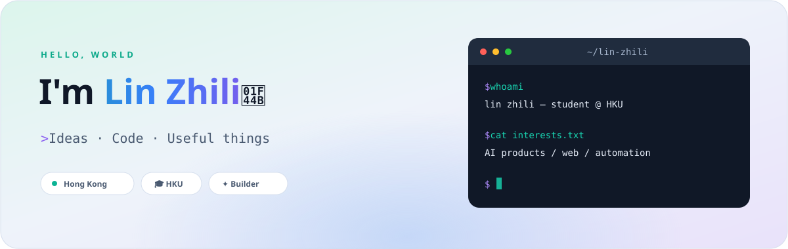

  

  
  &nbsp;
  
  &nbsp;
  

### 👨‍💻 About me

- 🎓 Currently studying at **The University of Hong Kong (HKU)**.
- 🛠️ I turn ideas into web apps, interactive experiences, and practical tools.
- 🌱 Exploring AI-powered products, automation, and creative interfaces.
- 🧪 Recent work spans household tools, 3D experiences, and personal portfolios.
- 💬 Say hello through [GitHub Discussions](https://github.com/lzllzllzllzllzl/lzllzllzllzllzl/discussions).

### 🧰 Tech stack

  

### ✨ Selected projects

| Project | What I'm building |
| :--- | :--- |
| [**Cyan Household**](https://github.com/lzllzllzllzllzl/cyan-household) | A household food inventory app with AI recognition and meal suggestions. |
| [**HaloWash**](https://github.com/lzllzllzllzllzl/HaloWash) | An interactive project built with React, TypeScript, and Three.js. |
| [**Lin Zhili Portfolio**](https://github.com/lzllzllzllzllzl/Lin-Zhili-Portfolio) | My personal portfolio, bringing projects and experience together. |

 

<b>Thanks for stopping by — let's build something useful.</b> ✨

  

